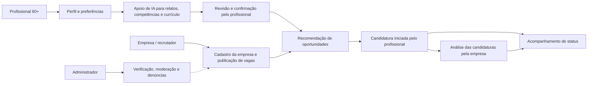
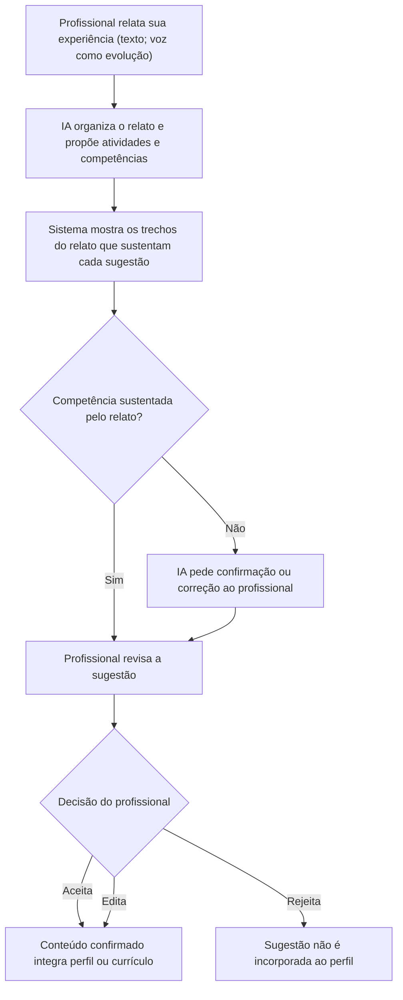

# 12.1 RT01 — Proposta e Especificação

> **Projeto:** Conecta Sênior · **Revisão técnica:** RT01 — Proposta e Especificação · **Atualização:** 17/11/2026
>
> **Natureza do documento:** consolidação documental da proposta e da especificação do projeto, elaborada a partir dos documentos do repositório de documentação, do repositório de código `conecta-senior-front` e de capturas de tela do protótipo.
>
> **Situação das informações:** nenhum requisito aqui consolidado possui, nas fontes analisadas, registro de aprovação formal pela equipe. O documento 14 afirma que não há comprovação suficiente de aprovação formal das funcionalidades, prioridades de backlog e decisões arquiteturais detalhadas. Por isso, todos os itens são tratados como **propostos**, mesmo quando possuem código e prioridade (§0.2).
>
> **Delimitação:** esta RT01 trata de proposta e especificação: o que o projeto pretende oferecer, requisitos, regras de negócio, prioridades, escopo e critérios de aceitação. O que foi desenvolvido, as tecnologias, a estrutura do código e as limitações de implementação são tratados na [RT03 — Desenvolvimento/MVP](12.3-rt03-desenvolvimento-mvp.md); testes, evidências, resultados de validação e a situação da entrega, na [RT04 — Validação e Finalização](12.4-rt04-validacao-e-finalizacao.md). A RT01 não reproduz nem substitui essas análises.

---

## 0. Como ler este documento

### 0.1 Origem das informações

Cada afirmação relevante é associada a uma das origens abaixo. A marcação classifica a natureza da fonte; as referências específicas (por exemplo, [06 §3.1], [WF-3], [C1], [CF: JobsPage.tsx]) permitem localizar a seção ou o arquivo.

| Marcação | Origem | Referências específicas |
|---|---|---|
| **[DOC]** | Informação registrada em documentação do projeto. Não equivale a aprovação formal, pois os próprios documentos de origem se declaram propostas a validar. | [01] a [18], [README], [Ficha], [PIA] |
| **[COD]** | Informação verificada diretamente no código do repositório `conecta-senior-front`. | [CF: arquivo] |
| **[WF]** | Informação observada nos wireframes do protótipo mobile (RT02). | [WF-1] a [WF-10] |
| **[CAP]** | Informação observada nas capturas de tela do protótipo web fornecidas para esta revisão. | [C1] a [C9] |
| **[INF]** | Inferência ou interpretação técnica desta revisão, não declarada diretamente nas fontes. | — |

**Limite de evidência.** Observar um elemento em wireframe **[WF]** ou em captura **[CAP]** não comprova que a funcionalidade esteja implementada ou funcione. Uma verificação no código **[COD]** também não comprova, por si só, o atendimento integral de um requisito de negócio. A ausência de um elemento nos materiais analisados não prova sua inexistência no projeto, nem indica rejeição do requisito.

### 0.2 Situação, grau de especificação e prioridade

A RT01 responde o que foi **proposto**, **especificado** e **priorizado**. Ela não classifica situação de implementação nem resultado de testes. A existência de elementos interativos, de navegação ou de estados locais em wireframe, captura ou código não comprova o atendimento integral dos requisitos de negócio correspondentes: a análise de implementação pertence à RT03, e a verificação por testes pertence à RT04.

Três dimensões independentes são usadas neste documento.

**Situação de aprovação**

| Valor | Uso |
|---|---|
| **Proposto** | Previsto em documento do projeto, sem registro de aprovação formal. É a situação de todos os itens deste documento. |
| **Aprovado** | Somente com evidência formal de aprovação pela equipe. Nenhuma foi identificada: [06], [07] e [15] declaram-se propostas a validar, e [14] informa ausência de comprovação de aprovação formal. |
| **Rejeitado** | Somente com evidência formal de rejeição. Nenhuma foi identificada nas fontes. |

**Grau de especificação** — avaliação desta revisão **[INF]**, aplicada por critério objetivo:

| Valor | Critério |
|---|---|
| **Especificado** | Possui código e enunciado verificável nas fontes, e nenhuma pendência (§11) afeta sua definição ou prioridade. |
| **Parcialmente especificado** | Possui enunciado, mas ao menos uma pendência (§11) ou regra não localizada afeta sua definição ou prioridade. |
| **Pendente de definição** | Não possui requisito com código nem enunciado suficiente nas fontes, ou sua inclusão no escopo depende de decisão da equipe. |

“Especificado” não significa aprovado, nem que exista critério de aceitação individual (§9).

**Prioridade e escopo**

| Valor | Significado | Origem |
|---|---|---|
| **P0** | Essencial ao MVP. | [06 §3] |
| **P1** | Melhoria após a validação inicial. | [06 §3] |
| **P2** | Evolução futura. | [06 §3] |
| **Fora do MVP** | Item declarado fora do MVP ou reservado a etapas posteriores. | [06 §13]; [05 §8] |

Os requisitos IA-01 a IA-08 trazem “prioridade sugerida” [07 §5], não aprovada. REP e RNS usam P0 e P1 próprios de [15 §7].

### 0.3 Convenção de citação

As referências usam o número do documento em `documentacao/` e a seção, por exemplo **[06 §3.1]**. Quando a fonte tem lista numerada sem títulos de subseção, **[06 §14.n]** indica o item *n* da lista. As demais fontes usam os códigos abaixo; os caminhos completos estão no §12.

| Código | Fonte | Marcação |
|---|---|---|
| **[README]** | `documentacao/README.md` (“Diagnóstico do Projeto”) | [DOC] |
| **[Ficha]** | `docs/.gitbook/assets/Ficha_Inscriçao_A3.pdf` | [DOC] |
| **[PIA]** | PDF “O Papel Definitivo da IA: O Tradutor de Carreiras e Mentor Empático” (`docs/.gitbook/assets/`) | [DOC] |
| **[WF-n]** | Tela *n* do wireframe do protótipo mobile (RT02): `documentacao/Imagens/imagem{n}.png`, também reunidas em `documentacao/.gitbook/assets/MVP.pdf` | [WF] |
| **[CF: arquivo]** | Código do repositório `conecta-senior-front` | [COD] |
| **[C1]–[C9]** | Capturas de tela do protótipo web, fornecidas para esta revisão (§10.1) | [CAP] |

Os códigos **RF**, **RNF**, **RN**, **IA**, **REP** e **RNS** são preservados exatamente como constam nas fontes. Os rótulos **PD-xx** (pendências) e **SCA-xx** (sugestões de critério de aceitação) foram criados somente nesta revisão, para navegação interna; **não são requisitos do projeto**.

---

## 1. Identificação e objetivo da proposta

### 1.1 Identificação

| Item | Conteúdo | Origem |
|---|---|---|
| Nome do projeto | Conecta Sênior | [01 §1] **[DOC]** |
| Conceito | Plataforma de empregabilidade e recolocação profissional para pessoas com 60 anos ou mais, que conecta profissionais experientes a empresas que valorizam conhecimento e experiência. | [01] (Conceito) **[DOC]** |
| Problema central | Dificuldade de aposentados e pessoas 60+ em obter oportunidades no mercado formal, por preconceito etário, limitações das plataformas tradicionais de recrutamento e falta de mecanismos que valorizem suas competências. | [01 §1] **[DOC]** |
| Público principal | Aposentados e profissionais 60+ que desejam continuar trabalhando, complementar a renda, retomar a carreira ou permanecer ativos. | [01 §1] **[DOC]** |
| Público secundário | Empresas, departamentos de RH e recrutadores que buscam profissionais experientes. | [01 §1] **[DOC]** |
| Contexto acadêmico | Projeto da UC Inteligência Artificial (A3), Grupo ANIMA Educação. Título provisório na ficha: “ConectaSenior”. O tema declarado inclui IA generativa e tecnologias de voz (STT/TTS). | [Ficha] **[DOC]** |

### 1.2 Problema que motivou o projeto

As fontes descrevem as seguintes barreiras para profissionais 60+ **[DOC]** [05 §2; 06 §1.1]:

- preconceito relacionado à idade nos processos seletivos;
- plataformas de emprego que não atendem plenamente a esse público;
- currículos que não destacam a experiência acumulada;
- processos de candidatura digitais complexos ou pouco acessíveis;
- filtros automatizados que podem valorizar formação recente ou histórico contínuo;
- falta de acesso a empresas dispostas a considerar profissionais seniores;
- dificuldade para identificar vagas confiáveis e acompanhar candidaturas.

O levantamento estatístico do projeto (IBGE/PNAD Contínua, 2012–2024) registra **[DOC]** [04 §3–§4]:

- crescimento das pessoas ocupadas com 60+ de 4,88 milhões (2012) para 8,32 milhões (2024);
- taxa de formalização de 44,27% entre ocupados 60+, contra 59,39% na média geral (2024);
- 51,15% dos ocupados 60+ atuando por conta própria ou como empregadores (2024).

O próprio documento adverte que esses números descrevem o contexto e **não demonstram que uma plataforma digital resolverá as barreiras identificadas**; essa relação depende de entrevistas, testes e piloto [04 §1, §12]. Os documentos [02] e [README] apresentam outros indicadores (por exemplo, sobre candidaturas em plataformas formais) cujas fontes completas não foram localizadas no repositório (PD-20).

### 1.3 Objetivos

**Objetivo geral.** Transformar a experiência profissional de pessoas 60+ em oportunidades reais de trabalho e geração de renda, reduzindo as barreiras de acesso ao mercado formal, sem permitir que a idade seja usada como critério injustificado de exclusão **[DOC]** [01 §2].

**Objetivos do software** **[DOC]** [06 §1.2]:

1. facilitar a criação de um perfil profissional e de um currículo;
2. conectar profissionais e empresas com informações claras sobre as oportunidades;
3. recomendar oportunidades considerando competências e preferências declaradas;
4. permitir candidaturas e acompanhamento de status;
5. oferecer experiência acessível, transparente e segura;
6. gerar indicadores para avaliar uso, compatibilidade e resultados do piloto.

**Objetivo da IA.** Traduzir experiências de vida e trabalho em oportunidades profissionais, por meio de interação acessível, acolhedora e transparente **[DOC]** [07 §1.2].

### 1.4 Contexto de utilização

- A plataforma prevê três perfis de uso: profissional 60+, empresa/recrutador e administrador **[DOC]** [06 §2].
- A interface deve ser utilizável em celulares, tablets e computadores **[DOC]** [05 §6; 06 RNF-03]. Aplicativos móveis nativos estão fora do MVP **[DOC]** [06 §13].
- O MVP deve alimentar um piloto controlado, com grupo delimitado de profissionais e empresas em uma região-piloto **[DOC]** [03 §5; 05 §12]. A região-piloto **não foi definida** nas fontes.

### 1.5 Resultado pretendido e seus limites

O projeto pretende ampliar o acesso a oportunidades compatíveis, valorizar competências e reduzir barreiras etárias injustificadas [05 §13; 03 §8] **[DOC]**. Os documentos declaram que esses são **objetivos a validar**: a plataforma não garante emprego, contratação ou eliminação do preconceito etário [03 §8; 05 §13].

---

## 2. Público-alvo e atores envolvidos

### 2.1 Atores previstos

| Ator | Relação com a plataforma | Necessidades e objetivos documentados | Origem |
|---|---|---|---|
| **Profissional 60+** (principal) | Cria conta e perfil, gera e revisa currículo, busca vagas, recebe recomendações, candidata-se e acompanha candidaturas. | Cadastro simples e acessível; currículo com apoio de IA; identificação de competências transferíveis; vagas compatíveis; informações transparentes sobre remuneração, jornada, modalidade e requisitos; acompanhamento; orientação; segurança contra vagas fraudulentas e uso indevido de dados. | [03 §1.2; 06 §2] **[DOC]** |
| **Empresa / recrutador** (secundário) | Cria conta institucional, cadastra a empresa, publica oportunidades, consulta candidaturas e perfis autorizados, atualiza status. | Acesso a talentos experientes; melhor compatibilidade entre candidatos e requisitos; menos barreiras no recrutamento; eficiência na divulgação e na organização das candidaturas; acompanhamento de resultados. | [03 §2; 06 §2] **[DOC]** |
| **Administrador** | Verifica empresas e oportunidades, modera conteúdo, trata denúncias, consulta indicadores operacionais. Papel privilegiado, restrito e auditável. | Operar a moderação e a confiabilidade da plataforma. | [06 §2; 15 §5.3; 18 §4] **[DOC]** |
| **Serviço de IA** (ator de sistema) | Recebe somente os dados estritamente necessários à tarefa solicitada, sem acesso amplo ao banco nem privilégios administrativos. | — | [15 §5.3] **[DOC]** |
| **Públicos indiretos e parceiros** | Famílias, organizações sociais e associações de aposentados, instituições de ensino, órgãos públicos e consultorias de recrutamento. | Apoio à divulgação, à inclusão digital, à capacitação e ao piloto. “Não precisam ser usuários diretos do sistema no MVP.” | [03 §3] **[DOC]** |

### 2.2 Diversidade do público

As fontes registram que o público 60+ **não é homogêneo** e que a plataforma não deve presumir limitações, necessidades ou familiaridade tecnológica semelhantes [03 §1, §4, §7; 05 §6; 04 §3.2] **[DOC]**. Os critérios de segmentação documentados são: objetivo profissional, situação profissional, experiência, familiaridade digital, disponibilidade, localização e perfil das empresas [03 §4]. A idade, isoladamente, não deve ser usada para presumir incapacidade, baixa familiaridade tecnológica, falta de produtividade ou preferência por determinado tipo de trabalho [03 §7; RN-12].

### 2.3 Priorização do público no MVP

| Prioridade | Público | Origem |
|---|---|---|
| 1 | Profissionais 60+ que procuram recolocação | [03 §5] **[DOC]** |
| 2 | Empresas com vagas compatíveis e abertas a contratar profissionais experientes | [03 §5] **[DOC]** |
| 3 | Parceiros de acesso e confiança (associações, organizações sociais, iniciativas de empregabilidade) | [03 §5] **[DOC]** |

### 2.4 Divergências sobre o público

- **Faixa etária.** [01] e [03] definem o público como 60+. O [README] inclui “pessoas aposentadas ou próximas da aposentadoria (55+)”. O documento [06 §14] pergunta se o MVP aceitará apenas 60+ (PD-01).
- **Familiares.** O [README] classifica “familiares que ajudam o idoso” como usuários secundários. O documento [03 §3] os trata como público indireto, que não precisa ser usuário direto no MVP (PD-19).

---

## 3. Proposta de solução

### 3.1 Proposta central

O Conecta Sênior é uma plataforma digital de empregabilidade que aproxima profissionais 60+ de empresas que valorizam experiência, reunindo oportunidades, perfis profissionais e ferramentas de IA em uma experiência simples, acessível e segura. O objetivo não é apenas publicar vagas, mas ajudar o profissional a apresentar sua trajetória, encontrar oportunidades compatíveis e acompanhar candidaturas **[DOC]** [05 §1].

A solução é organizada em quatro pilares **[DOC]** [01 §4]:

| Pilar | Direcionamento |
|---|---|
| Perfil profissional inteligente | Apoiar a criação e a melhoria de currículos, valorizando competências e experiências. |
| Matching inteligente | Recomendar vagas compatíveis com perfil, objetivos e disponibilidade. |
| Rede de oportunidades | Aproximar candidatos e empresas comprometidas com a inclusão etária. |
| Orientação profissional | Apoiar candidaturas, entrevistas, atualização de competências e retorno ao mercado. |

### 3.2 Como profissionais e empresas participam

- **Profissional:** cadastro simples → perfil → apoio ao currículo com IA → recomendação de oportunidades → candidatura → acompanhamento → orientação profissional **[DOC]** [05 §3.1].
- **Empresa:** cadastro → publicação de vagas → busca ou recebimento de candidatos → avaliação e seleção sob responsabilidade da empresa → retorno sobre o processo **[DOC]** [05 §3.2].
- **Administração:** verificação de empresas e vagas, tratamento de denúncias e consulta a indicadores **[DOC]** [06 §5.3].

Os fluxos detalhados estão no §8.

*Figura 1 — Visão de conjunto. Representação gráfica de [05 §3] e [06 §5], sem acréscimo de etapas.*

### 3.3 Papel da inteligência artificial

A IA é uma **ferramenta de apoio**, não a responsável pela decisão de contratação [06 §1; 05 §5; 07 §6] **[DOC]**. O documento [07] propõe quatro frentes. A coluna de prioridade reproduz as **prioridades sugeridas** em [07 §5], que o próprio documento declara não aprovadas.

| Frente | O que se pretende | Requisitos relacionados | Prioridade documentada |
|---|---|---|---|
| Entrevista guiada | Conversa orientada para conhecer a trajetória, com resumo editável confirmado pelo usuário. Texto no MVP; voz (STT/TTS) como evolução. | IA-01 (texto); IA-05 e IA-06 (voz) | P0 sugerida (texto); P1 sugerida (voz) |
| Tradutor de experiências | Transformar relatos em descrições profissionais e competências, mostrando os trechos que as sustentam. | IA-02, IA-03; RF-10, RF-11 | P0 |
| Recomendação de vagas | Comparar perfil validado e preferências com requisitos das oportunidades, com motivos compreensíveis. | IA-04; RF-26, RF-27 | P0 (RF-26, IA-04); P1 (RF-27) |
| Simulador de entrevistas | Treino com perguntas simuladas e devolutivas construtivas. | IA-07; RF-35 | P2 |

O selo de empresa inclusiva é um recurso proposto, sem critérios, processo de avaliação ou metodologia definidos [07 §3.3; 15 §3.7] (IA-08, P2 sugerida; PD-17). Empresas citadas em [07] e [PIA] como exemplos de varejistas **não** são parceiras confirmadas [07 §3.3].

---

## 4. Escopo funcional

### 4.1 Delimitação do escopo

O MVP é a primeira versão funcional, destinada a testar a proposta com usuários reais [05 §8] **[DOC]**.

**Funcionalidades prioritárias do MVP** [05 §8] **[DOC]**, coerentes com os itens P0 de [06 §3] e com [18 §4]:

1. cadastro e autenticação de profissionais;
2. criação e edição do perfil profissional;
3. cadastro de empresas e publicação de vagas;
4. busca e visualização de oportunidades;
5. candidatura a vagas e registro das candidaturas;
6. recomendações iniciais; [05 §8] prevê “critérios objetivos de compatibilidade”, mas a metodologia concreta (critérios, pesos, fórmula ou regras) **ainda não foi definida pela equipe** (PD-12);
7. assistência básica de IA para melhorar o currículo, com revisão pelo usuário;
8. painel simples para acompanhamento das candidaturas e gestão das vagas;
9. canal para sinalizar vagas suspeitas e solicitar suporte.

**Etapas posteriores** [05 §8] **[DOC]**: simulação avançada de entrevistas com IA; trilhas personalizadas de capacitação; integração com plataformas externas de recrutamento; relatórios avançados de diversidade e resultados; recomendações de mentoria, consultoria e trabalho por projeto; funcionalidades para parceiros institucionais; integrações automatizadas com sistemas corporativos de RH.

**Fora do MVP** [06 §13] **[DOC]**: aplicativos móveis nativos; videochamadas e entrevistas integradas; pagamentos, contratos e intermediação financeira; cursos completos e trilhas de capacitação; chat em tempo real entre todos os usuários; integrações com múltiplos portais de vagas; ranking automático de candidatos para decisão de contratação; modelos complexos de IA sem base de avaliação e explicabilidade.

### 4.2 Matriz de funcionalidades por área

Prioridades (P0, P1, P2) e códigos são os de [06]; **P0** = essencial ao MVP, **P1** = melhoria após validação inicial, **P2** = evolução futura [06 §3]. Na coluna *Aprovação e especificação* (§0.2), todos os itens são **Proposto**; o grau de especificação é uma avaliação **[INF]** aplicada pelo critério do §0.2 a partir das pendências (§11) associadas. Os requisitos estão detalhados no §5.

| Área | Funcionalidade | Ator | Requisitos | Prioridade | Origem | Aprovação e especificação |
|---|---|---|---|---|---|---|
| Cadastro e identificação | Cadastro de profissionais e de empresas | Profissional; Empresa | RF-01, RF-02 | P0 | [06 §3.1; 05 §8] | Proposto; parcialmente especificado (PD-01, PD-18) |
| Cadastro e identificação | Login, encerramento de sessão e recuperação de acesso | Todos | RF-03, RF-04 | P0 | [06 §3.1] | Proposto; parcialmente especificado (PD-21) |
| Cadastro e identificação | Permissões por perfil | Sistema | RF-05 | P0 | [06 §3.1; 15 §5.3] | Proposto; especificado |
| Cadastro e identificação | Atualização e exclusão de conta | Todos | RF-06 | P1 | [06 §3.1] | Proposto; parcialmente especificado (PD-26) |
| Perfil profissional | Registro de nome de exibição, localização aproximada, experiências, competências e formação; progresso e edição | Profissional | RF-07, RF-09 | P0 | [06 §3.2; 05 §3.1] | Proposto; parcialmente especificado (PD-18) |
| Preferências profissionais | Interesses, modalidade, disponibilidade e expectativa de remuneração (opcional) | Profissional | RF-08 | P0 | [06 §3.2] | Proposto; parcialmente especificado (PD-22) |
| Preferências profissionais | Escolha das informações visíveis a empresas | Profissional | RF-13 | P1 | [06 §3.2] | Proposto; parcialmente especificado (PD-05) |
| Experiências e competências (IA) | Coleta guiada de experiências por texto | Profissional; IA | IA-01 | P0 sugerida | [07 §3.1, §5] | Proposto; parcialmente especificado (PD-10) |
| Experiências e competências (IA) | Tradução de relatos em competências e texto de currículo, com revisão e aprovação | Profissional; IA | RF-10, RF-11, IA-02, IA-03 | P0 | [06 §3.2, §6.1; 07 §3.2, §5] | Proposto; parcialmente especificado (PD-16) |
| Currículo | Geração, visualização e exportação em PDF | Profissional | RF-12 | P1 | [06 §3.2] | Proposto; especificado |
| Busca e recomendação | Lista de oportunidades, detalhes, pesquisa e filtros | Profissional | RF-20, RF-21 | P0 | [06 §3.4] | Proposto; especificado |
| Busca e recomendação | Recomendação de oportunidades e explicação dos motivos | Profissional; IA | RF-26, RF-27, IA-04 | P0 (RF-26, IA-04); P1 (RF-27) | [06 §3.4, §6.2; 07 §3.3] | Proposto; parcialmente especificado (PD-12, PD-13) |
| Busca e recomendação | Salvar oportunidades; notificações | Profissional | RF-28, RF-29 | P1 | [06 §3.4] | Proposto; especificado |
| Candidaturas | Candidatura com confirmação explícita; bloqueio de duplicidade | Profissional | RF-22, RF-23 | P0 | [06 §3.4] | Proposto; parcialmente especificado (PD-26) |
| Acompanhamento | Status das candidaturas (profissional) e atualização de status (empresa) | Profissional; Empresa | RF-24, RF-25 | P0 | [06 §3.4] | Proposto; parcialmente especificado (PD-26) |
| Orientação profissional | Ajuda contextual em linguagem simples | Profissional; Empresa | RF-30 | P0 | [06 §3.5] | Proposto; parcialmente especificado (PD-26) |
| Orientação profissional | Orientação interativa por IA e simulador de entrevistas | Profissional; IA | RF-35, IA-07 | P2 | [06 §3.5; 07 §3.4] | Proposto; especificado |
| Orientação profissional | Dicas de currículo, entrevistas e desenvolvimento de competências | Profissional | — (sem código) | — | [05 §3.1, §4] | Proposto; pendente de definição (PD-15) |
| Empresas | Cadastro e atualização de dados institucionais | Empresa | RF-14 | P0 | [06 §3.3] | Proposto; especificado |
| Empresas | Publicação, edição, pausa, reabertura e encerramento de oportunidades | Empresa | RF-15, RF-16 | P0 | [06 §3.3] | Proposto; parcialmente especificado (PD-04, PD-22, PD-26) |
| Empresas | Consulta aos candidatos das próprias oportunidades | Empresa | RF-18 | P0 | [06 §3.3] | Proposto; especificado |
| Empresas | Busca ativa de profissionais que autorizaram visibilidade | Empresa | RF-19 | P2 | [06 §3.3] | Proposto; especificado |
| Administração e suporte | Revisão de empresas e remoção de oportunidades fraudulentas ou discriminatórias | Administrador | RF-17 | P0 | [06 §3.3] | Proposto; parcialmente especificado (PD-03) |
| Administração e suporte | Denúncias e painel administrativo; registro de eventos | Profissional; Empresa; Administrador | RF-31, RF-32, RF-33 | P0 | [06 §3.5] | Proposto; parcialmente especificado (PD-08) |
| Administração e suporte | Métricas agregadas do piloto | Administrador | RF-34 | P1 | [06 §3.5] | Proposto; parcialmente especificado (PD-07) |
| IA por voz | Conversa por reconhecimento de fala (STT) e respostas faladas (TTS) | Profissional; IA | IA-05, IA-06 | P1 sugerida | [07 §5] | Proposto; parcialmente especificado (PD-09) |
| Empresa inclusiva | Critérios auditáveis e selo de empresa inclusiva | Empresa; Administrador | IA-08 | P2 sugerida | [07 §3.3, §5] | Proposto; pendente de definição (PD-17) |

---

## 5. Requisitos funcionais

### 5.1 Base documental e convenções

- O documento [06 §3] contém **35 requisitos funcionais com código (RF-01 a RF-35)**: 26 de prioridade P0, 7 de P1 e 2 de P2. Os códigos e prioridades são preservados aqui sem renumeração.
- O documento [06] declara-se “proposta inicial para validação com a equipe e usuários”. Portanto, a situação de aprovação de todos os RF é **Proposto** (§0.2).
- Os documentos [07 §5] e [15 §7.1] acrescentam requisitos com códigos próprios (IA-01 a IA-08 e REP-01 a REP-10). Eles são listados separadamente (§5.3 e §5.4), com a correspondência aos RF, sem criar RF novos.
- A coluna **Ator** foi derivada da leitura direta do enunciado **[INF]**. A coluna **Relações** remete a regras de negócio, requisitos de outros documentos e pendências (§11).
- A coluna **Espec.** indica o grau de especificação **[INF]** conforme o critério do §0.2: **Esp.** = especificado; **Parcial** = parcialmente especificado, por haver pendência (PD) associada na coluna **Relações**. Dos 35 RF, 17 são classificados como especificados e 18 como parcialmente especificados; nenhum é classificado como pendente de definição.
- Os enunciados abaixo são sínteses fiéis de [06 §3]; em caso de dúvida, prevalece o texto do documento de origem.

### 5.2 Requisitos funcionais de [06 §3]

#### Contas e autenticação [06 §3.1]

| ID | Requisito | Ator | Prior. | Espec. | Relações |
|---|---|---|---|---|---|
| RF-01 | Permitir o cadastro de profissionais com as informações mínimas necessárias. | Profissional | P0 | Parcial | PD-01, PD-18 |
| RF-02 | Permitir o cadastro de empresas e recrutadores. | Empresa | P0 | Esp. | RF-14 |
| RF-03 | Permitir login e encerramento seguro de sessão. | Todos | P0 | Parcial | RNS-02, RNS-03; PD-21 |
| RF-04 | Permitir a recuperação de acesso por meio verificado. | Todos | P0 | Parcial | PD-21 |
| RF-05 | Aplicar permissões diferentes para profissional, empresa e administrador. | Sistema | P0 | Esp. | RN-04; RNS-03, RNS-04 |
| RF-06 | Permitir a atualização e a exclusão de conta, conforme regras de retenção e obrigações legais. | Todos | P1 | Parcial | REP-03; [15 §4.8]; PD-26 |

#### Perfil profissional e currículo [06 §3.2]

| ID | Requisito | Ator | Prior. | Espec. | Relações |
|---|---|---|---|---|---|
| RF-07 | Permitir registrar nome de exibição, localização aproximada, experiências, competências e formação. | Profissional | P0 | Parcial | PD-18 |
| RF-08 | Permitir informar interesses, modalidade de trabalho, disponibilidade e expectativa de remuneração (opcional). | Profissional | P0 | Parcial | PD-22 |
| RF-09 | Exibir progresso de preenchimento e permitir a edição do perfil. | Profissional | P0 | Esp. | REP-03 |
| RF-10 | Oferecer assistente de IA para organizar e melhorar a redação das experiências fornecidas pelo usuário. | Profissional; IA | P0 | Parcial | IA-02; RNF-10; PD-16 |
| RF-11 | Exigir revisão e confirmação do usuário antes de salvar texto sugerido pela IA. | Profissional | P0 | Esp. | RN-02; IA-03; REP-02 |
| RF-12 | Gerar currículo para visualização e exportação em PDF. | Profissional | P1 | Esp. | — |
| RF-13 | Permitir escolher quais informações do perfil ficam visíveis a empresas. | Profissional | P1 | Parcial | RN-11; REP-05; PD-05 |

#### Empresas e oportunidades [06 §3.3]

| ID | Requisito | Ator | Prior. | Espec. | Relações |
|---|---|---|---|---|---|
| RF-14 | Permitir que a empresa cadastre e atualize seus dados institucionais. | Empresa | P0 | Esp. | RF-02 |
| RF-15 | Permitir a publicação e a edição de oportunidades com título, descrição, requisitos, local, modalidade, jornada, remuneração ou faixa (quando disponível) e tipo de vínculo. | Empresa | P0 | Parcial | RN-06; PD-04, PD-22 |
| RF-16 | Permitir encerrar, pausar ou reabrir oportunidades conforme regras definidas. | Empresa | P0 | Parcial | RN-07; PD-26 |
| RF-17 | Permitir que administradores revisem empresas e removam oportunidades fraudulentas ou discriminatórias. | Administrador | P0 | Parcial | RN-03; PD-03 |
| RF-18 | Permitir que empresas consultem candidatos inscritos em suas próprias oportunidades. | Empresa | P0 | Esp. | RN-04 |
| RF-19 | Permitir busca ativa por profissionais que autorizaram essa visibilidade. | Empresa | P2 | Esp. | RF-13 |

#### Busca, recomendações e candidaturas [06 §3.4]

| ID | Requisito | Ator | Prior. | Espec. | Relações |
|---|---|---|---|---|---|
| RF-20 | Exibir a lista de oportunidades disponíveis e os detalhes de cada uma. | Profissional | P0 | Esp. | RN-06 |
| RF-21 | Permitir pesquisa e filtros por palavra-chave, localização, modalidade e área de atuação. | Profissional | P0 | Esp. | — |
| RF-22 | Permitir candidatura com confirmação explícita do profissional. | Profissional | P0 | Esp. | RN-08; REP-05 |
| RF-23 | Impedir candidaturas duplicadas à mesma oportunidade, salvo regra de reaplicação definida. | Sistema | P0 | Parcial | PD-26 |
| RF-24 | Exibir ao profissional suas candidaturas e os respectivos status. | Profissional | P0 | Esp. | RN-05 |
| RF-25 | Permitir que a empresa atualize o status: recebida, em análise, entrevista, encerrada ou não selecionada. | Empresa | P0 | Parcial | RN-09; PD-26 |
| RF-26 | Recomendar oportunidades com base em competências, interesses e condições informadas. | Profissional; IA | P0 | Parcial | IA-04; [06 §6.2]; PD-12 |
| RF-27 | Explicar, de maneira simples, os principais motivos de uma recomendação. | Profissional; IA | P1 | Parcial | REP-08; RNF-12; PD-13 |
| RF-28 | Permitir salvar oportunidades para consulta posterior. | Profissional | P1 | Esp. | — |
| RF-29 | Enviar notificações de mudança de status e de novas oportunidades, respeitando preferências. | Sistema | P1 | Esp. | REP-10 |

#### Suporte, administração e indicadores [06 §3.5]

| ID | Requisito | Ator | Prior. | Espec. | Relações |
|---|---|---|---|---|---|
| RF-30 | Oferecer ajuda contextual, com linguagem simples, nas etapas principais. | Todos | P0 | Parcial | PD-26 |
| RF-31 | Permitir denunciar oportunidades ou comportamentos suspeitos. | Todos | P0 | Esp. | RN-10; REP-07 |
| RF-32 | Disponibilizar painel administrativo para análise e tratamento de denúncias. | Administrador | P0 | Parcial | RN-10; PD-08 |
| RF-33 | Registrar eventos operacionais relevantes, com acesso restrito e sem expor informações desnecessárias. | Sistema | P0 | Esp. | RN-09; RNS-10 |
| RF-34 | Disponibilizar métricas agregadas de cadastros, vagas, candidaturas e evolução do piloto. | Administrador | P1 | Parcial | PD-07 |
| RF-35 | Disponibilizar orientação profissional interativa por IA, com avisos de limitação. | Profissional; IA | P2 | Esp. | IA-07 |

### 5.3 Requisitos de IA de [07 §5]

O documento [07] declara que as prioridades abaixo são **sugestões para planejamento, não uma definição já aprovada**, e que a voz, embora central na visão do documento-base, não foi priorizada para a primeira entrega.

| ID | Funcionalidade | Prioridade sugerida | Correspondência | Observação |
|---|---|---|---|---|
| IA-01 | Coleta guiada de experiências por texto | P0 — MVP | Sem RF equivalente em [06] | PD-10 |
| IA-02 | Tradução de relatos em competências e texto de currículo | P0 — MVP | RF-10 | — |
| IA-03 | Revisão e aprovação das sugestões antes de salvar | P0 — MVP | RF-11; RN-02; REP-02 | — |
| IA-04 | Recomendações iniciais de vagas com critérios explicáveis | P0 — MVP | RF-26; RF-27 (P1) | PD-13 |
| IA-05 | Conversa por voz com reconhecimento de fala (STT) | P1 — Evolução | Sem RF equivalente | PD-09 |
| IA-06 | Respostas faladas com síntese de voz (TTS) | P1 — Evolução | Sem RF equivalente | PD-09 |
| IA-07 | Simulador de entrevistas por texto e/ou voz | P2 — Futuro | RF-35 | — |
| IA-08 | Critérios auditáveis e selo de empresa inclusiva | P2 — Futuro | Sem RF equivalente | PD-17 |

### 5.4 Requisitos de ética e privacidade de [15 §7.1]

O documento [15] apresenta esses itens como **requisitos propostos**, e não como controles já implementados.

| ID | Requisito | Prior. | Correspondência |
|---|---|---|---|
| REP-01 | Identificar claramente quando o usuário interage com IA. | P0 | RNF-10, RNF-12 |
| REP-02 | Solicitar confirmação antes de inserir competências sugeridas em um currículo. | P0 | RF-11; RN-02 |
| REP-03 | Permitir corrigir e excluir informações do perfil. | P0 | RF-09; RF-06 (exclusão de conta, P1) |
| REP-04 | Oferecer alternativa textual à interação por voz. | P0 | Aplica-se se houver voz (PD-09) |
| REP-05 | Explicar os dados compartilhados ao enviar candidatura. | P0 | RF-13; RN-11 |
| REP-06 | Fornecer acesso ao aviso de privacidade e canal para direitos dos titulares. | P0 | RNF-06; PD-08 |
| REP-07 | Disponibilizar mecanismo de denúncia de vagas e condutas suspeitas. | P0 | RF-31; RN-10 |
| REP-08 | Mostrar justificativa compreensível das recomendações de vagas. | P1 | RF-27; PD-13 |
| REP-09 | Permitir revisão/contestação de recomendações e resultados relevantes. | P1 | Sem RF equivalente |
| REP-10 | Oferecer gestão detalhada de preferências de privacidade e comunicações. | P1 | RF-29 (parcial) |

---

## 6. Requisitos não funcionais

### 6.1 Requisitos de [06 §4]

As fontes apresentam diretrizes **qualitativas**. Nenhuma meta quantitativa de desempenho, disponibilidade ou capacidade foi definida, e [06 §4] adverte que essas metas ainda precisam ser definidas e “não devem ser tratadas como resultados já alcançados”.

| ID | Categoria | Requisito e critério de verificação documentado | Observação |
|---|---|---|---|
| RNF-01 | Acessibilidade | Adotar WCAG 2.2 nível AA **como meta**; validar navegação por teclado, foco visível, contraste, rótulos de campos e mensagens de erro compreensíveis. | Meta, não declaração de conformidade. |
| RNF-02 | Usabilidade | Permitir executar tarefas essenciais com textos claros, etapas curtas e feedback visível; validar em testes com profissionais 60+. | — |
| RNF-03 | Responsividade | Interface utilizável em celulares, tablets e computadores, sem perda de funções essenciais. | — |
| RNF-04 | Desempenho | Definir metas de carregamento e resposta após testes no ambiente real; monitorar rotas críticas e chamadas de IA. | Sem métricas (PD-23). |
| RNF-05 | Segurança | Proteger autenticação, senhas e sessões; validar entradas; aplicar controle de acesso no backend e proteção contra abuso. | Detalhado em RNS-01 a RNS-12. |
| RNF-06 | Privacidade / LGPD | Informar finalidades do tratamento, coletar somente dados necessários, estabelecer retenção e disponibilizar meios para solicitações dos titulares. | Requisito de projeto; não atesta conformidade. |
| RNF-07 | Confiabilidade | Tratar falhas de rede e de serviços externos sem perda silenciosa de dados; exibir mensagens recuperáveis. | — |
| RNF-08 | Observabilidade | Registrar logs técnicos, erros e métricas sem incluir dados pessoais sensíveis desnecessários. | — |
| RNF-09 | Manutenibilidade | Organizar o frontend em componentes reutilizáveis e o backend em módulos com testes e documentação. | Requisito de engenharia. |
| RNF-10 | IA responsável | Não inventar experiências, certificados ou competências; identificar sugestões geradas por IA e exigir revisão humana. | — |
| RNF-11 | Não discriminação | Não usar idade como filtro automático de exclusão ou critério de rejeição; revisar sinais de vieses nas recomendações. | — |
| RNF-12 | Transparência | Deixar claro quando uma funcionalidade usa IA e quais informações principais influenciam as recomendações. | PD-13 |
| RNF-13 | Compatibilidade | Testar os principais navegadores atuais e os dispositivos definidos pela equipe para o piloto. | Dispositivos não definidos (PD-23). |

### 6.2 Requisitos de segurança de [15 §7.2]

Todos com origem em [15 §7.2], como **requisitos propostos**; a legenda do documento indica que P0 é “essencial antes do lançamento do MVP” e P1 é “aprofundamento recomendado após a primeira entrega segura”.

| ID | Requisito | Prior. |
|---|---|---|
| RNS-01 | Criptografar o tráfego de comunicação por TLS. | P0 |
| RNS-02 | Armazenar senhas com hash seguro e parâmetros atualizados. | P0 |
| RNS-03 | Verificar autenticação e autorização no backend para operações protegidas. | P0 |
| RNS-04 | Isolar dados entre candidatos, empresas e administradores. | P0 |
| RNS-05 | Não armazenar segredos em código-fonte, frontend ou Git. | P0 |
| RNS-06 | Aplicar limites e proteção contra abuso nas APIs. | P0 |
| RNS-07 | Minimizar dados pessoais enviados a modelos de IA e fornecedores. | P0 |
| RNS-08 | Implantar backup e procedimento de restauração testável. | P0 |
| RNS-09 | Adotar autenticação multifator (MFA) para contas administrativas. | P0 |
| RNS-10 | Registrar eventos críticos sem expor dados pessoais desnecessários. | P0 |
| RNS-11 | Monitorar dependências e corrigir vulnerabilidades. | P1 |
| RNS-12 | Testar vieses e impactos das recomendações com dados apropriados. | P1 |

### 6.3 Diretrizes qualitativas sem código próprio

- **Autonomia e controle do usuário:** o profissional revisa e aprova o que a IA sugere, decide sobre candidaturas e pode recusar sugestões [RN-01, RN-02, RN-08; 15 §3.5] **[DOC]**.
- **Clareza nas interações com IA:** identificar o assistente como IA, diferenciar informação declarada de sugestão inferida e indicar que a compatibilidade é uma estimativa, não uma promessa [15 §3.2] **[DOC]**.
- **Retenção de dados:** o documento [15 §4.8] determina que a política seja definida antes do lançamento e **não apresenta prazos numéricos**; esta revisão também não os define.
- **Conformidade legal:** a LGPD e a WCAG aparecem como diretriz ou meta. [15] declara que não constitui parecer jurídico nem atesta conformidade já implementada. **Este documento não declara conformidade com a LGPD, com a WCAG ou com qualquer outra norma.**

---

## 7. Regras de negócio e critérios de funcionamento

### 7.1 Regras de negócio de [06 §7]

| ID | Regra | Relações |
|---|---|---|
| RN-01 | O profissional é responsável por confirmar a veracidade das informações do seu perfil. | RF-07 |
| RN-02 | Sugestões da IA só podem substituir dados do perfil após aprovação explícita do usuário. | RF-11; REP-02 |
| RN-03 | Apenas empresas autorizadas podem publicar oportunidades visíveis no piloto. | RF-17; PD-03 |
| RN-04 | Uma empresa só pode visualizar candidaturas vinculadas às próprias oportunidades. | RF-18; RNS-04 |
| RN-05 | O profissional pode visualizar todas as candidaturas realizadas em sua conta. | RF-24 |
| RN-06 | Toda oportunidade deve conter descrição, requisitos, modalidade e tipo de vínculo; campos adicionais devem ser incentivados. | RF-15; PD-04 |
| RN-07 | Uma oportunidade encerrada não aceita novas candidaturas. | RF-16 |
| RN-08 | A candidatura deve ser iniciada pelo profissional, não executada automaticamente pela IA. | RF-22 |
| RN-09 | Alterações relevantes de status devem ficar registradas para rastreabilidade. | RF-25, RF-33 |
| RN-10 | O sistema deve disponibilizar mecanismo de denúncia e revisão de conteúdos suspeitos. | RF-31, RF-32 |
| RN-11 | Informações pessoais não devem ser compartilhadas com empresas fora das finalidades e permissões informadas. | RF-13; REP-05 |
| RN-12 | A idade pode caracterizar o público-alvo, mas não deve ser usada para inferir incapacidade, excluir automaticamente ou reduzir recomendações. | RNF-11 |

**Informações que compõem uma oportunidade.** RN-06 torna obrigatórios descrição, requisitos, modalidade e tipo de vínculo; RF-15 lista também título, local, jornada e remuneração ou faixa “quando disponível” **[DOC]**.

### 7.2 Regras de funcionamento da IA documentadas

| Regra | Origem |
|---|---|
| A IA apoia a preparação e a descoberta de oportunidades; a decisão de candidatura é do profissional e a decisão de contratação é humana. | [06 §1, §6.2; 05 §5.3; 07 §6; 15 §3.5] |
| A IA não pode criar experiências, datas, certificados, empresas, qualificações, cargos ou resultados não informados. Em caso de dúvida, deve solicitar confirmação. | [06 §6.1; 07 §3.2; 15 §3.3; RNF-10] |
| Cada competência sugerida deve ser acompanhada dos trechos do relato que a sustentam; competência não sustentada pelo relato (exemplo: controle de estoque) só é incorporada se o usuário confirmar. | [07 §3.2; 15 §3.3] |
| O usuário pode editar, aceitar ou rejeitar o texto sugerido, e só o conteúdo confirmado integra perfil ou currículo. | [06 §6.1; RN-02; 15 §3.3] |
| A recomendação inicial usa lógica explicável baseada em competências, interesses, localização, modalidade e disponibilidade; a equipe pode combinar regras e IA, desde que os resultados possam ser avaliados. | [06 §6.2] |
| É vedado rejeitar candidatos automaticamente por idade e atribuir “pontuação de empregabilidade” como verdade objetiva. A seleção permite revisão humana. | [06 §6.2; RN-12; RNF-11] |
| A compatibilidade é apresentada como estimativa, sem promessa de contratação. | [15 §3.2; 06 §6.2] |
| A empresa não deve receber conclusão automatizada de “apto” ou “inapto” sem contexto, e recomendações não devem bloquear candidaturas silenciosamente. | [15 §3.5] |
| Idade, ano de formação ou períodos sem emprego não devem ser usados como substitutos automáticos de capacidade profissional. | [05 §5.3; 01 §2] |
| O assistente não deve afirmar ser humano, terapeuta, médico ou representante de empresa, nem pressionar o usuário a aceitar vagas. | [15 §3.6] |
| O uso de voz é opcional: deve haver alternativa em texto. | [07 §2; 15 §4.4; REP-04] |

### 7.3 Compartilhamento de dados com empresas

O documento [15 §4.5] recomenda, para o MVP, que a empresa acesse apenas os dados necessários à oportunidade, que a plataforma apresente ao profissional quais informações serão compartilhadas em cada candidatura e que o acesso de recrutadores fique associado à empresa e sujeito a registro. Trata-se de **modelo recomendado**, ainda dependente da decisão PD-05.

### 7.4 O que as fontes não definem

Não foram localizados nas fontes, e **não são criados aqui**: algoritmo de compatibilidade, pontuações, pesos, fórmulas ou critérios de elegibilidade; regra de reaplicação a uma oportunidade; regras para pausar, reabrir ou encerrar vagas; transições permitidas entre os status de candidatura; critérios de verificação de empresas; definição de quais são as “etapas principais” que terão ajuda contextual (PD-26).

---

## 8. Fluxos e casos de uso

Os fluxos abaixo reproduzem as jornadas documentadas. Quando as fontes não registram condições iniciais ou fluxos alternativos, isso é informado, e nenhuma etapa foi acrescentada.

### 8.1 Fluxo do profissional

| Campo | Conteúdo |
|---|---|
| Ator | Profissional 60+ |
| Objetivo | Apresentar sua experiência, encontrar oportunidades compatíveis, candidatar-se e acompanhar o andamento. [05 §3.1; 06 §5.1] |
| Condições iniciais | Não documentadas formalmente. O fluxo parte do acesso à página inicial [06 §5.1]. |
| Fluxo principal (MVP) [06 §5.1] | 1. Acessa a página inicial e entende a proposta. 2. Cria uma conta e entra na plataforma. 3. Preenche informações profissionais em etapas curtas. 4. Usa, se desejar, a IA para melhorar a apresentação do currículo e aprova as alterações. 5. Visualiza oportunidades, utiliza filtros e recebe recomendações iniciais. 6. Abre os detalhes de uma oportunidade e confirma a candidatura. 7. Acompanha o status da candidatura em seu painel. |
| Resultado esperado | Candidatura registrada e status visível no painel do profissional. As fontes ressalvam que o fluxo não garante contratação [05 §9]. |
| Variações documentadas | **Com entrevista guiada (visão de IA):** escolha entre voz e texto, entrevista de diagnóstico, tradução de competências com confirmação, revisão e salvamento do perfil, vagas com justificativas, preparação opcional com simulador e candidatura por decisão própria [07 §4]. **Orientação profissional** após o acompanhamento [05 §3.1, passo 7]. |
| Exceções e restrições documentadas | O uso da IA é opcional [06 §5.1]; o usuário pode rejeitar sugestões [06 §6.1]. Candidatura duplicada é impedida (RF-23). Oportunidade encerrada não aceita candidaturas (RN-07). Falhas de rede ou de serviços externos não podem causar perda silenciosa de dados (RNF-07). A recuperação de acesso deve usar meio verificado (RF-04). A denúncia de vaga suspeita é uma funcionalidade prevista (RF-31); o ponto do fluxo em que ocorre **não é especificado**. |

### 8.2 Fluxo da empresa

| Campo | Conteúdo |
|---|---|
| Ator | Empresa / recrutador |
| Objetivo | Divulgar vagas e selecionar candidatos, com a decisão de seleção sob responsabilidade humana. [05 §3.2; 03 §2] |
| Condições iniciais | Não documentadas formalmente. O fluxo parte da criação de conta [06 §5.2]. |
| Fluxo principal (MVP) [06 §5.2] | 1. Cria conta e cadastra os dados da empresa. 2. Passa por verificação ou moderação conforme a política do piloto. 3. Publica oportunidade com condições e requisitos claros. 4. Recebe candidaturas e visualiza os perfis enviados. 5. Atualiza o status do processo seletivo. |
| Resultado esperado | Candidaturas organizadas e status atualizado para o profissional. [06 §5.2; RF-24, RF-25] |
| Variações documentadas | Busca de candidatos, recomendações de candidatos e retorno sobre o processo constam em [05 §3.2]; a busca ativa é P2 (RF-19) e o retorno sobre contratações é “quando possível”. |
| Exceções e restrições documentadas | A empresa só vê candidaturas das próprias oportunidades (RN-04). Apenas empresas autorizadas publicam vagas visíveis no piloto (RN-03). O administrador pode remover oportunidades fraudulentas ou discriminatórias (RF-17). A **política de verificação não está definida** (PD-03). |

### 8.3 Fluxo do administrador

| Campo | Conteúdo |
|---|---|
| Ator | Administrador |
| Objetivo | Manter a confiabilidade da plataforma por meio de moderação e tratamento de denúncias. [06 §2, §5.3; 18 §4] |
| Condições iniciais | Acesso com permissão específica [06 §5.3]. As fontes propõem MFA para contas administrativas (RNS-09). |
| Fluxo principal [06 §5.3] | 1. Acessa o painel com permissão específica. 2. Analisa empresas, vagas e denúncias sinalizadas. 3. Aprova, solicita correção, suspende ou remove conteúdos conforme a política publicada. 4. Consulta registros de auditoria e indicadores básicos. |
| Resultado esperado | Conteúdos suspeitos tratados e ações registradas (RN-09, RN-10). |
| Observação | A “política publicada” citada em [06 §5.3] não foi localizada nas fontes (PD-26). |

### 8.4 Revisão do conteúdo gerado pela IA

O diagrama representa as etapas descritas em [07 §3.2], [06 §6.1] e [15 §3.3], sem acréscimo de etapas. O ramo “Rejeita” expressa que a sugestão não é incorporada ao perfil, consequência de RF-11 e RN-02 **[INF]**.

*Figura 2 — Revisão humana do conteúdo gerado por IA.*

### 8.5 Status de candidatura

O requisito RF-25 enumera cinco status: **recebida**, **em análise**, **entrevista**, **encerrada** e **não selecionada**. As fontes **não definem as transições permitidas** entre eles; por isso nenhum diagrama de estados é apresentado (PD-26).

---

## 9. Critérios de aceitação

### 9.1 Critérios definidos em [06 §10]

O documento [06 §10] define 13 critérios para considerar o MVP “funcional para um piloto controlado”. Todos aparecem como itens **não marcados** na fonte. Este documento **não registra resultado de verificação** de nenhum deles.

| N.º | Critério (síntese) | Requisitos relacionados |
|---|---|---|
| 1 | Profissional consegue cadastrar-se, entrar e recuperar acesso. | RF-01, RF-03, RF-04 |
| 2 | Profissional consegue preencher e editar o perfil sem assistência obrigatória. | RF-07, RF-08, RF-09 |
| 3 | A IA sugere melhorias no currículo sem inserir fatos não fornecidos. | RF-10; RNF-10 |
| 4 | Profissional consegue revisar e aprovar ou rejeitar as sugestões da IA. | RF-11; RN-02 |
| 5 | Empresa autorizada consegue publicar e encerrar oportunidades. | RF-15, RF-16; RN-03 |
| 6 | Profissional consegue pesquisar, filtrar e ver detalhes das oportunidades. | RF-20, RF-21 |
| 7 | O sistema apresenta recomendações iniciais baseadas em critérios definidos. | RF-26 (os critérios ainda não estão definidos, PD-12; o critério não é verificável até que o sejam) |
| 8 | Profissional consegue candidatar-se e acompanhar o status. | RF-22, RF-24 |
| 9 | Empresa consegue visualizar e atualizar as candidaturas recebidas. | RF-18, RF-25; RN-04 |
| 10 | Administrador consegue revisar denúncias e moderar oportunidades. | RF-17, RF-31, RF-32 |
| 11 | Perfis diferentes não acessam dados ou ações sem permissão. | RF-05; RN-04; RNS-03, RNS-04 |
| 12 | Jornadas essenciais passam por testes básicos de acessibilidade e usabilidade com o público-alvo. | RNF-01, RNF-02 |
| 13 | Erros e falhas de integração são tratados sem perder informações confirmadas. | RNF-07 |

### 9.2 Critérios definidos em [15 §8]

O documento [15 §8] define outros 13 critérios, também não marcados, voltados a ética, privacidade e segurança. Síntese:

| N.º | Critério (síntese) | Relacionados |
|---|---|---|
| 1 | Usuário cadastra e edita os próprios dados sem ver dados privados de outras contas. | RF-09; RNS-04 |
| 2 | Empresa não acessa candidatos de outra organização por alteração de identificadores de URL ou API. | RN-04; RNS-03 |
| 3 | A IA não publica experiências ou competências sem revisão explícita. | RF-11; REP-02 |
| 4 | A interface informa quando a IA está ativa e permite o fluxo essencial por texto. | REP-01, REP-04 |
| 5 | O microfone só é ativado mediante ação e permissão do usuário. | Aplica-se se houver voz (PD-09) |
| 6 | A candidatura mostra quais informações serão disponibilizadas à empresa. | REP-05 |
| 7 | Avisos de privacidade e canais de solicitação de direitos estão acessíveis. | REP-06 |
| 8 | Há procedimento definido para denúncias e resposta a incidentes. | REP-07; RN-10 |
| 9 | Senhas e segredos não aparecem em código, logs ou respostas de API. | RNS-02, RNS-05, RNS-10 |
| 10 | Logs críticos registram eventos relevantes sem conteúdos desnecessários. | RF-33; RNS-10 |
| 11 | A recuperação de backups foi validada em ambiente de teste. | RNS-08 |
| 12 | O fluxo de IA foi testado contra conteúdo malicioso em vagas, currículos e transcrições. | [15 §5.6] |
| 13 | Fornecedores de IA, voz e hospedagem foram avaliados quanto a dados, segurança e retenção. | RNS-07; PD-06 |

### 9.3 Requisitos sem critério de aceitação correspondente

Nenhum dos critérios de [06 §10] ou [15 §8] cobre, de forma explícita, os requisitos **RF-02, RF-06, RF-12, RF-13, RF-14, RF-19, RF-23, RF-27, RF-28, RF-29, RF-30, RF-34 e RF-35**. Entre eles, são P0: **RF-02, RF-14, RF-23 e RF-30**.

### 9.4 Sugestões de critério a validar

As formulações abaixo são **derivadas diretamente do texto dos requisitos** e **não foram aprovadas pela equipe**. Servem apenas como ponto de partida para validação **[INF]**.

| Rótulo | Sugestão de critério | Derivada de |
|---|---|---|
| SCA-01 | Uma empresa consegue criar conta, cadastrar seus dados institucionais e atualizá-los. | RF-02, RF-14 |
| SCA-02 | Ao tentar candidatar-se novamente à mesma oportunidade, o sistema não registra uma segunda candidatura, exceto se houver regra de reaplicação definida. | RF-23 |
| SCA-03 | A candidatura só é registrada após confirmação explícita do profissional. | RF-22; RN-08 |
| SCA-04 | A empresa consegue atribuir a uma candidatura cada um dos cinco status listados em RF-25, e o profissional visualiza o status atualizado. | RF-24, RF-25 |
| SCA-05 | Uma oportunidade encerrada não permite novas candidaturas. | RN-07 |
| SCA-06 | A empresa consegue pausar, reabrir e encerrar uma oportunidade própria, conforme regras ainda a definir (PD-26). | RF-16 |

SCA-02, SCA-04 e SCA-06 remetem expressamente a regras ainda não definidas (PD-26) e, por isso, não pressupõem decisão da equipe. Não é possível formular critério verificável para RF-26 (recomendações) enquanto os critérios de compatibilidade não forem definidos (PD-12), nem para RF-30 enquanto as “etapas principais” não forem identificadas (PD-26).

---

## 10. Relação entre a especificação e os materiais visuais do protótipo

Esta seção relaciona os requisitos aos wireframes do protótipo mobile e às capturas do protótipo web, para delimitar o escopo e apontar diferenças e elementos que dependem de decisão da equipe. **Ela não avalia a implementação:** wireframes e capturas não comprovam funcionamento (§0.1). A análise de desenvolvimento, de código e de limitações de implementação está na [RT03](12.3-rt03-desenvolvimento-mvp.md); a de testes e evidências, na [RT04](12.4-rt04-validacao-e-finalizacao.md). As menções ao código são contextuais e resumidas.

### 10.1 Materiais observados

- **Wireframes do protótipo mobile (RT02) [WF]:** 10 telas em `documentacao/Imagens/imagem1.png` a `imagem10.png`, reunidas em `documentacao/.gitbook/assets/MVP.pdf` (PDF sem texto extraível, lido visualmente) e navegáveis em `documentacao/12.2-rt02-prototipo.html`. Títulos da galeria: Boas-vindas, Cadastro de usuário, Entrevista guiada, Currículo gerado por IA, Preferências profissionais, Vagas recomendadas, Detalhes da vaga, Confirmação de candidatura, Acompanhamento de candidaturas e Conversa com a empresa. Os contadores de etapa mostram “Passo 1 de 6” a “Passo 6 de 6”. As telas são citadas como [WF-1] a [WF-10], na ordem da galeria.
- **Protótipo web:** observado por **capturas de tela [CAP]** e, de forma contextual, pelo código `conecta-senior-front` **[COD]**, que organiza o fluxo em nove telas (boas-vindas e oito etapas). A tela de boas-vindas declara tratar-se de ambiente de demonstração com vagas e perfis ilustrativos [CF: WelcomePage.tsx].
- **Capturas de tela fornecidas para esta revisão** (não versionadas no repositório de documentação). A numeração C1–C9 segue a ordem de envio dos arquivos; por isso, **C5 corresponde à quarta pergunta e C6 à terceira**, e a sequência real das perguntas é C3, C4, C6, C5.

| Código | Arquivo | O que a captura permite observar |
|---|---|---|
| C1 | `1794860723683_image.png` | Passo 1 de 8: campo de e-mail e aviso “Mock: neste momento aceitamos qualquer e-mail”. |
| C2 | `1794860729260_image.png` | Passo 2 de 8: campos “Seu nome completo” e “Sua idade”; aviso de confidencialidade. |
| C3 | `1794860734830_image.png` | Passo 3 de 8, pergunta 1 de 4: experiência profissional mais relevante. |
| C4 | `1794860738856_image.png` | Passo 3 de 8, pergunta 2 de 4: habilidades mais valorizadas no trabalho. |
| C5 | `1794860744322_image.png` | Passo 3 de 8, pergunta 4 de 4: motivação para continuar aprendendo; botão “Finalizar entrevista”. |
| C6 | `1794860751127_image.png` | Passo 3 de 8, pergunta 3 de 4: situação em que resolveu um problema complexo. |
| C7 | `1794860756052_image.png` | Passo 5 de 8: tipo de trabalho e área de interesse (na captura, “Presencial” e “Vendas” aparecem selecionados). |
| C8 | `1794860761152_image.png` | Passo 7 de 8: cartões de vagas com cargo, empresa, etiquetas, descrição, motivo, percentual de compatibilidade e botão “Candidatar-me”. |
| C9 | `1794860765899_image.png` | Passo 8 de 8: perfil com os dados informados no teste, “Minhas candidaturas” (sem candidaturas na captura) e “Recomendações para você”. |

Não há captura das telas de boas-vindas, de currículo resumido (passo 4) e da tela transitória de busca (passo 6). Os dados pessoais digitados durante o teste e visíveis em [C9] não são reproduzidos neste documento.

### 10.2 Correspondência entre requisitos, wireframes e capturas

A coluna **Ponto de atenção** registra apenas diferenças entre os materiais e a especificação, ou dependências de decisão. “Não identificado nos materiais analisados” significa ausência de evidência nesses materiais, e não prova de inexistência ou de rejeição.

| Tema (requisitos) | Previsto na especificação | Wireframes [WF] | Capturas [CAP] | Ponto de atenção |
|---|---|---|---|---|
| Cadastro e autenticação (RF-01, RF-03, RF-04) | Cadastro, login, encerramento de sessão e recuperação de acesso. | [WF-2]: nome, idade, telefone ou e-mail e senha; “Já tenho conta”. | [C1]: apenas e-mail, com aviso de que qualquer e-mail é aceito e de que o login com senha virá futuramente. [C2]: nome e idade. | Campos e método de autenticação diferem entre wireframe e protótipo web (PD-21). Login, encerramento de sessão e recuperação de acesso não foram identificados nos materiais analisados. |
| Perfil e preferências (RF-07, RF-08) | Nome de exibição, localização aproximada, experiências, competências, formação; interesses, modalidade, disponibilidade e remuneração opcional. | [WF-5]: tipo de trabalho (meio período, temporário, remoto, presencial) e área de interesse (atendimento, administrativo, vendas, educação). | [C7]: as mesmas opções; uma opção selecionada por grupo na captura. | Localização, formação, disponibilidade e remuneração não foram identificadas nos materiais analisados. Não aparece a opção “híbrido”, citada em [07 §3.3]; o agrupamento “Tipo de trabalho” difere da separação entre modalidade, jornada e vínculo de RF-15 (PD-22). |
| Coleta guiada (IA-01) | Conversa orientada em texto, com voz como evolução; sem número de perguntas definido. | [WF-3]: três perguntas, “Anexar currículo” (PDF ou Word) e “Responder falando”. | [C3]–[C6]: quatro perguntas abertas em texto, com “Voltar” e “Próxima pergunta”. Voz e anexo não aparecem. | Número e conteúdo das perguntas, voz e anexo não têm definição nas fontes (PD-09, PD-10, PD-11). A obrigatoriedade das respostas não é determinável pelas capturas; consta da análise de código na RT03. |
| Currículo e revisão (RF-10, RF-11, IA-02, IA-03, REP-01) | A IA organiza e traduz as experiências; o usuário revisa e confirma; a IA é identificada. | [WF-4]: rótulo “Gerado por IA”, aviso “Exemplo ilustrativo” e botões “Editar currículo” e “Aprovar currículo”. | Sem captura desta etapa. | Os elementos de identificação da IA e de revisão previstos nos requisitos estão no wireframe. A correspondência no protótipo web deve ser confirmada na RT03. |
| Busca e detalhes (RF-20, RF-21) | Lista, detalhes, pesquisa e filtros (P0). | [WF-6], [WF-7]: lista de duas vagas e tela de detalhes; filtros não aparecem. | [C8]: cartões de vagas; campo de busca e filtros não aparecem na captura. | Busca e filtros (P0) não foram identificados em nenhum material visual analisado. |
| Recomendação e compatibilidade (RF-26, RF-27, IA-04) | Recomendar por competências, interesses e condições; explicar os motivos. | [WF-6], [WF-7]: “% compatível” e “Mostrando as 2 melhores vagas”. | [C8]: percentual e o mesmo texto de motivo (“Combina com o que você contou.”) nos dois cartões visíveis. Entre [C7] e [C8], as preferências selecionadas (“Presencial”, “Vendas”) e as primeiras vagas exibidas (meio período, atendimento e administrativo) não coincidem; [C9] mostra duas vagas administrativas como recomendação. | O percentual não tem método definido nas fontes (PD-12), e a explicação das recomendações tem prioridades divergentes (PD-13). As capturas não permitem determinar o critério usado; ver RT03. |
| Candidatura (RF-22, RN-08, REP-05) | Candidatura com confirmação explícita; explicação dos dados compartilhados. | [WF-7], [WF-8]: detalhes com “Seu currículo será enviado automaticamente”, “Candidatar-me agora” e tela de confirmação. | [C8]: botão “Candidatar-me” no cartão. Confirmação não aparece. | O wireframe prevê uma etapa de confirmação, mas não informa quais dados serão compartilhados (REP-05; PD-05). Etapa de confirmação não identificada nas capturas. |
| Acompanhamento (RF-24, RF-25) | O profissional vê os status; a empresa os atualiza. | [WF-9]: status “Entrevista marcada”, “Em análise” e “Não selecionado”. | [C9]: seção “Minhas candidaturas” sem candidaturas. | Atualização de status pela empresa não identificada em wireframes ou capturas (transições não definidas: PD-26). |
| Mensagens com a empresa | Sem requisito; chat em tempo real entre todos os usuários está fora do MVP [06 §13]. | [WF-10]: conversa com a empresa; botões “Tenho interesse” e “Pode ligar para mim”. | Não identificado. | Elemento sem correspondência em requisito (PD-14). |
| Empresa e administração (RF-02, RF-14 a RF-19, RF-31 a RF-34) | Cadastro de empresa, vagas, candidaturas, moderação, denúncias e métricas. | Nenhuma tela de empresa ou administração; [WF-10] mostra apenas a mensagem da empresa vista pelo profissional. | Não identificado. | A ausência nos materiais não indica rejeição dos requisitos; a existência no código é tratada na RT03. |
| Idade e público (RF-01, RN-12) | Público 60+; decisão sobre aceitar outras faixas pendente. | [WF-2]: campo “Sua idade”. | [C2]: campo de idade sem indicação de faixa; [C9] exibe a idade informada no teste. | A faixa 60+ não aparece como regra visível nos materiais; a finalidade da coleta de idade não consta de RF-07 (PD-01, PD-18). |
| Progresso (RF-09) | Progresso de preenchimento do perfil. | “Passo X de 6”. | “Passo X de 8” em [C1]–[C9]. | Os contadores indicam a etapa do fluxo, e não o percentual de preenchimento do perfil **[INF]**; o número de etapas difere entre os materiais. |
| Funcionamento real (dados, IA, voz) | Persistência, assistente de IA e, como evolução, voz. | Rótulos e botões (“Gerado por IA”, “Responder falando”) representam a intenção de design. | Mostram estados da interface. | Wireframes e capturas não permitem verificar persistência, processamento por IA ou voz. A análise consta da RT03; a verificação, da RT04. |

### 10.3 Diferenças, elementos sem correspondência e decisões necessárias

- **Entre wireframes e protótipo web:** o número de etapas (6 e 8), os campos de cadastro e alguns recursos aparecem em um material e não foram identificados no outro (voz e anexo de currículo, aprovação do currículo, detalhes da vaga e mensagens com a empresa). Cabe à equipe indicar qual material é a referência da especificação (PD-09, PD-10, PD-11, PD-14, PD-21).
- **Elementos sem correspondência clara em requisitos:** conversa com a empresa (PD-14); anexo de currículo existente (PD-11); percentual de compatibilidade (PD-12); coleta de idade (PD-18); agrupamento “Tipo de trabalho” (PD-22).
- **Requisitos P0 sem representação visual identificada nos materiais analisados:** pesquisa e filtros (RF-21), recuperação de acesso (RF-04), cadastro e gestão de empresas e vagas (RF-02, RF-14 a RF-18), denúncia e moderação (RF-31 a RF-33). Isso não indica rejeição nem inexistência; a RT03 trata de sua existência no código.
- A existência de tela, de wireframe ou de código **não foi usada como prova** de que a funcionalidade integrava a especificação original, nem de que está implementada.

---

## 11. Pendências, lacunas e divergências

Os rótulos PD-xx são deste documento (§0.3). Na revisão de consistência de 17/11/2026, nenhuma pendência foi dada como resolvida, porque nenhuma fonte disponível registra decisão formal; PD-01, PD-10, PD-21, PD-25 e PD-26 receberam apenas ajustes textuais. PD-01 e PD-18 (idade) e PD-04 e PD-22 (campos de oportunidade) têm temas próximos, mas tratam de decisões distintas e foram mantidas separadas. A coluna **Tipo** distingue: decisão já registrada como pendente em [06 §14]; lacuna de informação; divergência entre fontes; e divergência entre especificação e protótipo. A coluna de responsável **não foi preenchida**: as fontes não atribuem responsáveis, e esta revisão não os define.

| ID | Tipo | Descrição | Origem | Itens afetados |
|---|---|---|---|---|
| PD-01 | Decisão pendente | O MVP aceitará apenas pessoas 60+ ou também pré-cadastro de outras faixas? O [README] cita público 55+; nos materiais visuais analisados, o campo de idade não indica restrição de faixa. | [06 §14.1; README; C2; WF-2] | RF-01; RN-12 |
| PD-02 | Decisão pendente | O piloto priorizará vagas formais, serviços autônomos ou ambos? [05 §8] deixa mentoria, consultoria e trabalho por projeto para etapa posterior, enquanto [07 §3.3] os lista entre critérios de recomendação e [06 §1.1] cita emprego formal, projeto e serviços. | [06 §14.2; 05 §8; 07 §3.3; 04 §8] | RF-15; RF-26 |
| PD-03 | Decisão pendente | Como será feita a verificação de empresas e a moderação de oportunidades? | [06 §14.3] | RF-17; RN-03 |
| PD-04 | Decisão pendente | Quais campos de remuneração e de vínculo serão obrigatórios? RN-06 já torna o vínculo obrigatório e RF-15 trata a remuneração como “quando disponível”, mas [06 §14.4] mantém a pergunta aberta. | [06 §14.4, §7] | RF-15; RN-06 |
| PD-05 | Decisão pendente | Quais informações recrutadores poderão ver antes da candidatura? | [06 §14.5; 15 §4.5] | RF-13, RF-18; RN-11; REP-05 |
| PD-06 | Decisão pendente | Qual provedor e modelo de IA será usado e quais dados poderão ser enviados a ele? | [06 §14.6, §9; 07 §7] | RF-10; RNS-07 |
| PD-07 | Decisão pendente | Quais métricas e metas mínimas definirão o sucesso do piloto? | [06 §14.7, §12] | RF-34 |
| PD-08 | Decisão pendente | Quem tratará solicitações de privacidade e denúncias? [15 §6.1] recomenda papéis, mas não atribui responsáveis. | [06 §14.8; 15 §6.1] | RF-32; REP-06 |
| PD-09 | Divergência entre fontes | A voz (STT/TTS) integra o MVP? [07 §5] a classifica como P1 sugerida; [18 §4] a condiciona a definição e viabilidade; a [Ficha] inclui STT/TTS no tema do projeto; [WF-3] traz “Responder falando”. [07 §5] prevê antecipar IA-05 e IA-06 se a equipe definir a voz como indispensável. | [07 §5; 18 §4; Ficha; WF-3] | IA-05, IA-06; REP-04 |
| PD-10 | Lacuna | A entrevista guiada é obrigatória ou opcional? Quantas e quais perguntas? [15 §3.1] exige que quem prefere preencher o currículo diretamente possa fazê-lo; o protótipo web apresenta quatro perguntas e o wireframe, três. | [07 §3.1; 15 §3.1; C3–C6; WF-3] | IA-01 |
| PD-11 | Lacuna | O envio de currículo existente (PDF ou Word) aparece apenas em [WF-3], sem requisito. [15 §5.4] prevê proteção de uploads “se houver envio”. | [WF-3; 15 §5.4] | — |
| PD-12 | Lacuna | O percentual de compatibilidade será exibido? O que significa e como é obtido? As fontes não definem; [06 §6.2] veda “pontuação de empregabilidade” como verdade objetiva e [15 §3.2] exige tratar a compatibilidade como estimativa. | [06 §6.2; 15 §3.2; WF-6; C8] | RF-26; critério 7 de [06 §10] |
| PD-13 | Divergência entre fontes | A explicação das recomendações é P1 em RF-27 e REP-08, mas [07 §5] (IA-04, P0 sugerida) e [06 §6.2] falam em critérios ou lógica “explicável” no MVP, e RNF-12 não tem prioridade. | [06 §3.4, §4, §6.2; 07 §5; 15 §7.1] | RF-27; IA-04; REP-08; RNF-12 |
| PD-14 | Divergência spec × protótipo | O wireframe traz conversa com a empresa, mas não há requisito de mensagens e [06 §13] exclui chat em tempo real entre todos os usuários. | [WF-10; 06 §13] | — |
| PD-15 | Lacuna | A orientação profissional é um pilar [01 §4] e uma funcionalidade [05 §3.1, §4], mas não tem requisito nem prioridade; RF-35 (P2) cobre apenas orientação interativa por IA. | [01 §4; 05 §4; 06 §3.5] | RF-30; RF-35 |
| PD-16 | Divergência entre fontes | O assistente de IA para currículo está no MVP (P0) em [05 §8] e [06 RF-10, RF-11], mas [01 §6] o situa na Fase 3, posterior ao MVP. | [01 §6; 05 §8; 06 §3.2] | RF-10, RF-11 |
| PD-17 | Lacuna | O selo de empresa inclusiva não possui critérios, processo, verificação nem revisão definidos. | [07 §3.3; 15 §3.7] | IA-08 |
| PD-18 | Lacuna | A idade é coletada pelo protótipo e pelo wireframe, mas não consta de RF-07 nem dos dados de cadastro em [15 §4.2]. [15 §4.10] pede justificar a finalidade de cada dado. | [06 §3.2; 15 §4.2, §4.10; C2; WF-2] | RF-01, RF-07 |
| PD-19 | Divergência entre fontes | Familiares: usuários secundários no [README]; público indireto, sem necessidade de uso direto no MVP, em [03 §3]. | [README; 03 §3] | §2 |
| PD-20 | Divergência entre fontes | [02] e [README] trazem indicadores (por exemplo, sobre candidaturas em plataformas formais) e remetem a uma página “Bibliografia” ausente do repositório; [04] usa a PNAD 2012–2024; [01] pede validação dos números em fontes oficiais; [07 §11] não adotou o índice de 57% atribuído à FGV/IBRE. | [02; README; 04; 01; 07 §11] | §1.2 |
| PD-21 | Divergência spec × protótipo | Estratégia de autenticação não definida em [06 §9]; o protótipo web solicita apenas e-mail e informa que futuramente haverá login com senha [C1]; o wireframe pede senha e “telefone ou e-mail”. | [06 §9; C1; WF-2] | RF-03, RF-04; RNS-02 |
| PD-22 | Divergência spec × protótipo | RF-15 separa modalidade, jornada e vínculo; [07 §3.3] cita presencial, híbrido e remoto; [04 §8] distingue formal, informal e autônomo. O protótipo agrupa “meio período, temporário, remoto e presencial” em um único “Tipo de trabalho”. | [06 §3.3; 07 §3.3; 04 §8; C7] | RF-08, RF-15 |
| PD-23 | Lacuna | Faltam metas quantitativas (carregamento, disponibilidade, capacidade) e a definição de navegadores e dispositivos do piloto. | [06 §4] | RNF-04, RNF-13 |
| PD-24 | Lacuna | Não há registro de aprovação formal das funcionalidades, prioridades P0–P2 e IA-01 a IA-08; entrevistas e questionários com o público-alvo constam como “ainda não realizados”. | [14; README; 06 (status); 07 (status)] | Todos os requisitos |
| PD-25 | Lacuna | No inventário da cópia do repositório analisada (arquivos enviados em 16/11/2026), os documentos 08, 09, 10, 11, 12 (`12.-revisoes-tecnicas.md`), 13, 16 e 17 continham apenas o título. A RT01 foi preenchida por esta revisão. RT03 e RT04 também continham apenas o título nessa cópia; a solicitação da revisão corretiva informa que receberam conteúdo, mas suas versões atuais não foram disponibilizadas (§12.2). **O inventário deve ser reconfirmado no repositório atual.** Permanecem registrados: [SUMMARY] aponta `12.2-rt02-prototipo.md`, mas existe `12.2-rt02-prototipo.html`, cuja galeria referencia `../documentação/Imagens/` (com acento), diferente do diretório existente; [04] cita a pasta `Conecta_Senior_assets/`, inexistente na cópia analisada. | Repositório de documentação (cópia analisada) | Rastreabilidade |
| PD-26 | Lacuna | Regras não localizadas: reaplicação (RF-23); pausar, reabrir e encerrar vagas (RF-16); transições de status (RF-25); “etapas principais” com ajuda contextual (RF-30); política de moderação “publicada” [06 §5.3]; política de retenção e eliminação de dados (RF-06). | [06 §3, §5.3; 15 §4.8] | RF-06, RF-16, RF-23, RF-25, RF-30 |
| PD-27 | Divergência entre fontes | O exemplo do [PIA] traduz o relato da lanchonete incluindo “Controle de Estoque”; [07 §3.2] e [15 §3.3] só aceitam essa competência com confirmação do usuário. Este documento segue [07] e [15]. | [PIA; 07 §3.2; 15 §3.3] | RF-10; RF-11 |

---

## 12. Fontes, verificações e limitações

### 12.1 Fontes consultadas

| Fonte | Caminho | Conteúdo verificado | Uso |
|---|---|---|---|
| Documentos 01 a 07 | `documentacao/01.-…` a `07.-…` | Conteúdo substantivo. [06] e [07] declaram-se propostas a validar. | Base da RT01 |
| Documento 14 | `documentacao/14.-registro-do-uso-da-ia.md` | Registro parcial de uso de IA; informa a ausência de comprovação de aprovação formal. | Situação dos requisitos |
| Documento 15 | `documentacao/15.-etica-privacidade-e-seguranca.md` | Diretrizes propostas, REP, RNS e critérios; “não constitui parecer jurídico”. | Requisitos e regras |
| Documento 18 | `documentacao/18.-preparacao-para-a-banca.md` | Roteiro de apresentação; declara que não se deve apresentar como implementado o que não foi demonstrado. | Conferência do escopo do MVP |
| Diagnóstico | `documentacao/README.md` | Resumo consolidado com dados e referências diferentes de [04]. | Divergências |
| Sumário e configuração | `documentacao/SUMMARY.md`; `gitbook-docs.yaml` | Estrutura e links. | PD-25 |
| Documentos sem conteúdo (cópia analisada) | `documentacao/08`, `09`, `10`, `11`, `12.-revisoes-tecnicas`, `13`, `16`, `17` | **Somente título** na cópia analisada; reconfirmar no repositório atual (PD-25). | Nenhum |
| RT03 e RT04 | `documentacao/12.3-rt03-desenvolvimento-mvp.md`; `documentacao/12.4-rt04-validacao-e-finalizacao.md` | Somente título na cópia disponível. A solicitação desta revisão informa que receberam conteúdo, mas as versões atuais **não foram disponibilizadas nem lidas**. | Apenas como referência de delimitação (§10) |
| Arquivo-alvo (antes) | `documentacao/12.1-rt01-proposta-e-especificacao.md` | **Somente o título** “12.1 RT01 — Proposta e Especificação”, preservado. | Este documento |
| Galeria RT02 | `documentacao/12.2-rt02-prototipo.html`; `documentacao/galeria/`; `documentacao/Imagens/imagem1.png` a `imagem10.png` | Galeria de 10 telas de wireframe; imagens conferidas visualmente. | §10 |
| Wireframes | `documentacao/.gitbook/assets/MVP.pdf` | 1 página, sem texto extraível; lida visualmente; corresponde às 10 telas de `Imagens/`. | §10 |
| Ficha de inscrição | `docs/.gitbook/assets/Ficha_Inscriçao_A3.pdf` | Texto extraído: tema, título provisório e identificação do grupo. Dados pessoais dos integrantes não foram reproduzidos. | §1.1; PD-09 |
| Papel da IA (PDF) | `docs/.gitbook/assets/O Papel Definitivo da IA_ O _Tradutor de Carreiras_ e Mentor Empático.pdf` | Texto extraído; 2 páginas. | §3.3; PD-27 |
| Demais arquivos de `docs/` | `docs/README.md`; `docs/SUMMARY.md`; `docs/o-papel-definitivo-….md` | Ficha, prompts de governança e referência ao PDF; os prompts não foram usados como fonte de requisitos. | — |
| Código | `conecta-senior-front`: `README.md`, `AGENTS.md`, `CHANGELOG.md`, `AI_USAGE.md` (leitura parcial), `package.json`, `src/` (`App.tsx`, `contexts/`, `hooks/`, `pages/`, `mocks/`, `services/`, `RegistrationForm`, `HeroPageTemplate`) | Leitura do código-fonte e busca textual em `src/`. Arquivos de infraestrutura (Docker, Makefile, configurações) não foram analisados por não serem pertinentes à RT01. | §10 |
| Capturas de tela | `1794860723683_image.png` a `1794860765899_image.png` (9 arquivos) | Examinadas visualmente (§10.1). | §10 |

### 12.2 Limitações desta revisão

- **Sem aprovação nem validação com usuários.** Os requisitos refletem documentos que se declaram propostas. Não há registro de entrevistas ou questionários com o público-alvo (PD-24).
- **O código não foi executado.** As observações sobre o protótipo vêm dos wireframes, das capturas de tela (que mostram estados da interface, e não comportamento) e de leitura contextual do código; a análise de implementação pertence à RT03.
- **Dados estatísticos e referências externas** (IBGE, BNE, FGV/IBRE, LGPD, ANPD, WCAG) foram citados como constam nos documentos e **não foram reverificados** nas fontes originais.
- **Não se afirma conformidade** com a LGPD, a WCAG ou qualquer norma, nem se declaram testes realizados ou resultados de validação.
- **RT03 e RT04 não lidas.** A conferência cruzada entre RT01, RT03 e RT04 (coerência das descrições de RF, RNF, IA, REP e RNS, referências cruzadas e inventários) **não pôde ser realizada**, e esses arquivos não foram alterados. As referências da RT01 a RT03 e RT04 limitam-se à delimitação de responsabilidades.
- **Arquitetura e UX:** na cópia analisada, os documentos 08 (Experiência e Interface) e 09 (Arquitetura e Tecnologias) estão vazios. As diretrizes técnicas citadas (React, Vite, API em Go, banco, armazenamento KV) constam de [06 §9], [07 §7] e [18 §7] como planejamento, e **[06 §9] informa que banco, provedor de IA, infraestrutura, autenticação e implantação ainda dependem de decisão da equipe**. Por isso, tecnologias não foram tratadas como requisitos funcionais.
- **Registro de uso de IA:** a elaboração desta revisão foi apoiada por ferramenta de IA. O documento [14] orienta registrar tais usos; esse registro **não foi feito** aqui e depende da equipe.

---

## 13. Controle de revisões

Não havia, no arquivo original, seção de histórico nem registros anteriores; o conteúdo existente era apenas o título, que foi preservado.

| Data | Responsável | Alterações |
|---|---|---|
| 16/11/2026 | Não informado | Elaboração do conteúdo da RT01: identificação e objetivo, público e atores, proposta, escopo, requisitos funcionais, não funcionais, regras de negócio, fluxos, critérios de aceitação, relação com o protótipo, pendências e fontes. Consolidados RF-01 a RF-35, RNF-01 a RNF-13, RN-01 a RN-12, IA-01 a IA-08, REP-01 a REP-10 e RNS-01 a RNS-12, com códigos e prioridades preservados. Registradas 27 pendências, lacunas e divergências (PD-01 a PD-27). |
| 17/11/2026 | Não informado | Revisão corretiva da RT01, sem reelaboração do documento. (1) Cabeçalho e §10: delimitação atualizada em relação à RT03 e à RT04, com links. (2) §0.1 a §0.2: convenção de origem reorganizada ([DOC], [COD], [WF], [CAP], [INF]); estados separados em situação de aprovação, grau de especificação e prioridade/escopo; retirada da classificação de implementação e substituição da afirmação sobre funcionalidades implementadas. (3) §4.2 e §5.2: grau de especificação indicado por critério objetivo ([INF]); RF-06 passou a referenciar PD-26. (4) §4.1: descrição de recomendações ajustada (metodologia de compatibilidade não definida, PD-12). (5) §9.4: ressalvas sobre sugestões SCA e SCA-06. (6) §10 refocada em wireframes e capturas, com ordem C1–C9 corrigida e formulações delimitadas de ausência de evidência. (7) §11: ajustes textuais em PD-01, PD-10, PD-21, PD-25 e PD-26; PD-01 a PD-27 preservadas. (8) §12: RT03 e RT04 registradas como não lidas e conferência cruzada pendente. Requisitos, prioridades e códigos não foram alterados. |